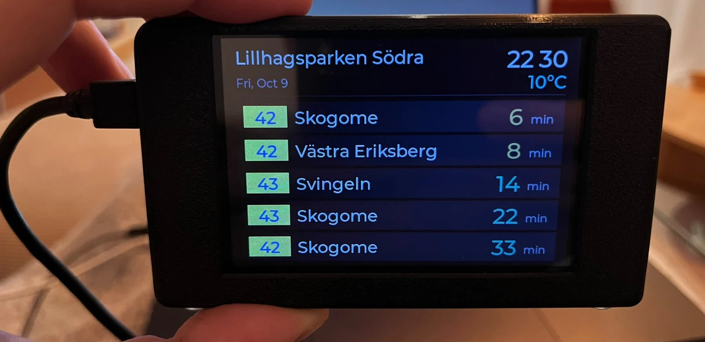

# Västtrafik Bus Stop Display

A small ESP32 screen for your hallway wall that shows the **next departures from your Västtrafik stop**,
the clock, the date and the temperature. Live, in Swedish time, and set up from your phone.

> **Unofficial.** This is a hobby project and is not affiliated with or endorsed by Västtrafik.

## Who is this for?

People who live in **Västtrafik's area** in Sweden (Västra Götaland, for example Göteborg, Borås, Skövde and
Trollhättan). It uses Västtrafik's *Planera Resa* API, so it only knows Västtrafik stops, and it is built for
Swedish time (CET/CEST). It will not work for other transport companies or countries without changes.

## What it does

- Live departures with the real line colors. Delays are included in the minutes and cancelled buses are marked.
- Clock with a blinking colon and correct summer/winter time. The temperature comes from
  [Open-Meteo](https://open-meteo.com), with no key needed.
- Screen brightness follows the time of day with smooth fades. Tap the screen to wake it.
- **Set up from your phone:** choose WiFi, enter your Västtrafik key and pick your bus stop on a web page.
  Nothing secret is in the code.
- If the internet goes away it keeps counting down and shows "No connection".
- Updates over WiFi, with Arduino IDE, the command line, or a small Mac app.

## What you need

- A **3.5" ESP32 display board** (480x320, ST7796 screen, GT911 capacitive touch) and a USB data cable. Which
  board it was built on, where to buy it, and the pins: [docs/hardware.md](docs/hardware.md).
- A **free Västtrafik key**: [docs/vasttrafik-api-key.md](docs/vasttrafik-api-key.md). Get it first.
- A computer with **Windows, macOS or Linux**, and a phone.
- Optional: the 3D-printed case in [`case/`](case).

## Quick start

1. Get your Västtrafik key.
2. Follow **[docs/getting-started.md](docs/getting-started.md)**. It covers Arduino IDE, the board package, the
   libraries and uploading, for Windows, macOS and Linux.
3. Join the WiFi `BusStop-Setup` with your phone and fill in the setup page.

## Using it

| Do this | To get this |
| --- | --- |
| Tap the screen | Full brightness for 30 seconds |
| Hold the screen for 4 seconds | Open the setup page again |
| Press BOOT within 2 seconds after power-on | Open the setup page |

If the WiFi is gone for 15 minutes, the setup page opens by itself. Trouble? See
[docs/troubleshooting.md](docs/troubleshooting.md).

## Updating the code

See **[docs/updating.md](docs/updating.md)**: USB cable, over WiFi from Arduino IDE, `arduino-cli`, or the
macOS app.

## Customizing

Most settings are in [`busstop/config.h`](busstop/config.h):

- **Weather location:** the latitude and longitude in `kWeatherUrl` (default: Göteborg). Change them to your town.
- **Brightness** by time of day, how long a tap wakes the screen, how often data is refreshed.

## Project layout

| Path | What it is |
| --- | --- |
| `busstop/` | The Arduino sketch (the firmware). Keep the folder name. |
| `busstop/tools/BusStopUpdater/` | The macOS update app (SwiftUI) and its zip |
| `docs/` | Guides, and the settings files for the screen libraries |
| `case/` | The 3D-printable case |

Code map: `busstop.ino` runs everything. `ui.*` draws the screen, `vasttrafik.*` and `weather.*` fetch data,
`time_service.*` and `iso_time.h` handle time, `backlight.*`, `gt911.*` and `touch.*` handle brightness and
touch, `setup_portal.*` and `setup_page.h` are the phone setup page, `wifi_manager.*` and `ota.*` do WiFi and
updates.

## License and credits

- Code: [MIT License](LICENSE). 3D case and photos: [CC BY-SA 4.0](case/LICENSE).
- Uses LVGL, TFT_eSPI, ArduinoJson, the Montserrat font and the Open-Meteo weather data, which keep their own
  licenses: see [THIRD_PARTY_NOTICES.md](THIRD_PARTY_NOTICES.md).
- Want to help? See [CONTRIBUTING.md](CONTRIBUTING.md).
