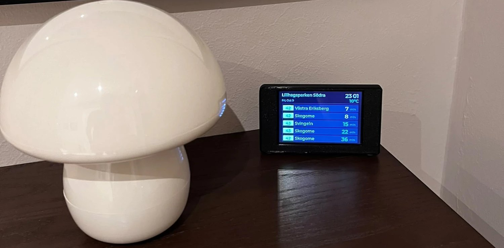

# 3D-printed case

A case for the 3.5" ESP32 display board described in [docs/hardware.md](../docs/hardware.md), made to sit on a shelf or hallway table.

## Files

| File | What it is |
| --- | --- |
| [`stl/busstop_front.stl`](stl/busstop_front.stl) | The front part: holds the screen board. About 110 x 64 x 50 mm. |
| [`stl/busstop_back.stl`](stl/busstop_back.stl) | The back plate. About 108 x 57 x 5 mm. |
| [`source/busstop.f3d`](source/busstop.f3d) | The editable design, for [Autodesk Fusion](https://www.autodesk.com/products/fusion-360) (free for personal use). Change it and export new STL files. |

Print the two `.stl` files. If you want to change the design, open the `.f3d` file in Fusion. Designed by
Bruno Fornari.

<!-- TODO (maintainer): add a STEP export of the design (Fusion: File > Export > STEP) so people with other CAD
programs can edit it too. -->

## Print settings

| Setting | Value |
| --- | --- |
| Printer | Bambu Lab A1 mini |
| Material | PLA |
| Layer height | 0.2 mm |
| Other settings | The normal (default) profile, nothing special |
| Supports | Not needed |

Print the front and the back as two separate parts.

<!-- TODO (optional, maintainer): add print time, infill and the orientation of each part, if you want. -->

## Assembly

<!-- TODO (maintainer): describe how the board fits, whether screws or glue are needed, and the cable exit. -->

## License

This case is released under the **Creative Commons Attribution-ShareAlike 4.0 International** license
([CC BY-SA 4.0](LICENSE)). You may share and change it, also commercially, if you give credit and share your
changes under the same license.
